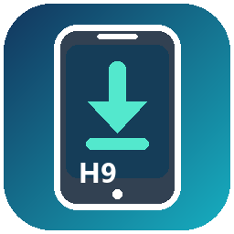

<p align="center">
  
</p>

<h1 align="center">Honor 9 · HarmonyOS 2 Installer</h1>

<p align="center">
  Неофициальный офлайн-установщик HarmonyOS 2.0.0.150 для Honor 9 под Windows
  <br>
  <em>Unofficial Windows offline installer for Honor 9</em>
</p>

<p align="center">
  <a href="../../releases/latest"></a>
  
  
</p>

<p align="center">
  <a href="../../releases/latest/download/Honor9-HarmonyOS2-Downloader.exe">
    
  </a>
</p>

> [!CAUTION]
> Установка полностью удаляет внутреннюю память и может привести к
> неработоспособности телефона. `USERLOCK` и `FBLOCK` должны быть
> **UNLOCKED**. После установки bootloader нельзя блокировать.
> **Используйте пакет на свой страх и риск.**

## Что умеет EXE

| | Возможность |
|---:|---|
| ⬇️ | Докачивает файлы из актуального GitHub Release после обрыва |
| 🔐 | Проверяет SHA-256 каждого asset и итогового `payload.7z` |
| 📦 | Сам распаковывает base ZIP и собирает части payload |
| 📱 | Проверяет модель STF, USERLOCK, FBLOCK и версию системы |
| 🛠️ | Выполняет прошивку и показывает единый журнал без CMD-окон |
| 🔔 | Подсказывает ручной вход в Fastboot/TWRP и продолжает ожидание |
| 💾 | Сохраняет уникальные разделы телефона перед изменениями |

После подготовки файлов интернет во время самой прошивки не требуется.

## Быстрый старт

1. Прочитайте [полную EXE-инструкцию на русском](EXE-GUIDE-RU.md).
2. Разблокируйте USERLOCK и отключите FBLOCK по
   [отдельной инструкции](FBLOCK-GUIDE-RU.md).
3. Скачайте
   [`Honor9-HarmonyOS2-Downloader.exe`](../../releases/latest/download/Honor9-HarmonyOS2-Downloader.exe).
4. Нажмите **1. Скачать и подготовить**.
5. Вручную войдите в Fastboot: выключите телефон, зажмите уменьшение громкости
   и подключите USB.
6. Нажмите **2. Проверить телефон** и продолжайте только после `CHECK PASSED`.
7. Нажмите **3. Прошить телефон** и введите `STF-HARMONY-ERASE`.
8. Дождитесь `DONE`; первая загрузка может занять 10–15 минут.

Если появится `MANUAL ACTION REQUIRED` для TWRP: отключите USB, выключите
телефон, зажмите питание + громкость вверх, после логотипа отпустите питание и
держите громкость вверх до TWRP. Затем снова подключите USB.

## Поддерживаемые модели

| Модель | Статус |
|---|---|
| `STF-AL10` | ✅ Проверено на реальном устройстве |
| `STF-AL00`, `STF-TL10` | 🧪 Экспериментально |
| `STF-L09`, `STF-L19` | ⚠️ Экспериментально; возможны отличия связи, NFC и калибровок |

Huawei P10, Honor 9 Lite, Honor 9X и устройства без кода `STF` отклоняются.

## Статус PREAS

`v1.1.0` использует изменённый минимальный `/china` PREAS с AVB algorithm
`NONE`, проверенный на STF-AL10. Signed-пункт в EXE отключён.

Полный официальный DLOAD 2.0.0.140 C00 был проверен и **не содержит PREAS**.
Европейский подписанный `/oversea`-образ несовместим с C00 и намеренно не
публикуется как вариант установки. Подробности:
[`SIGNED-PREAS-STATUS.md`](SIGNED-PREAS-STATUS.md).

## Документация

| Раздел | Русский | English |
|---|---|---|
| Установка через EXE | [Открыть](EXE-GUIDE-RU.md) | [Open](EXE-GUIDE-EN.md) |
| Полное руководство | [Открыть](README-RU.md) | [Open](README-EN.md) |
| Отключение FBLOCK | [Открыть](FBLOCK-GUIDE-RU.md) | [Open](FBLOCK-GUIDE-EN.md) |
| Signed PREAS | [Статус](SIGNED-PREAS-STATUS.md) | [Status](SIGNED-PREAS-STATUS.md) |
| История изменений | [CHANGELOG](CHANGELOG.md) | [CHANGELOG](CHANGELOG.md) |
| Устройство проекта | [Architecture](docs/ARCHITECTURE.md) | [Architecture](docs/ARCHITECTURE.md) |

## Что установщик сохраняет

- собственный OEMINFO телефона до патча;
- NVME, modemnvm, persist и secure storage;
- исходные kernel, recovery и eMMC boot-разделы;
- SHA-256 резервных образов и журнал установки.

Установщик не подменяет IMEI, серийный номер и заводские калибровки, не
прошивает чужой OEMINFO и не форматирует microSD.

> [!IMPORTANT]
> Папка `backups` содержит уникальные данные устройства. Никогда не загружайте
> её в Issues и не передавайте посторонним. Для диагностики используйте только
> проверенный и очищенный файл из `logs`.

## Для разработчиков

Исходник GUI находится в [`downloader/Program.cs`](downloader/Program.cs).
EXE собирается штатным компилятором .NET Framework:

```powershell
powershell -ExecutionPolicy Bypass -File .\downloader\build.ps1
```

Предложения и отчёты об ошибках принимаются по правилам из
[`CONTRIBUTING.md`](CONTRIBUTING.md).

## Правовой статус

Это не продукт Huawei/Honor. Скрипты, сторонние инструменты и firmware имеют
разных правообладателей; уведомления находятся в
[`THIRD-PARTY-NOTICES.txt`](THIRD-PARTY-NOTICES.txt). Образы firmware
распространяются только как Release assets.
